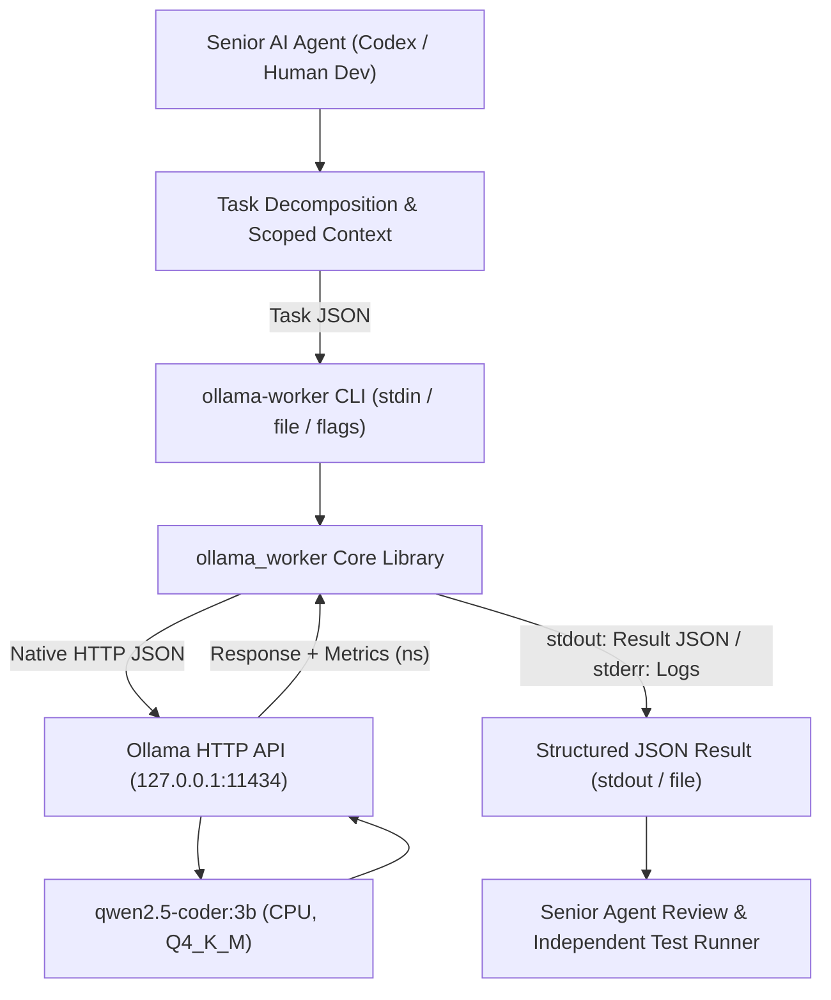
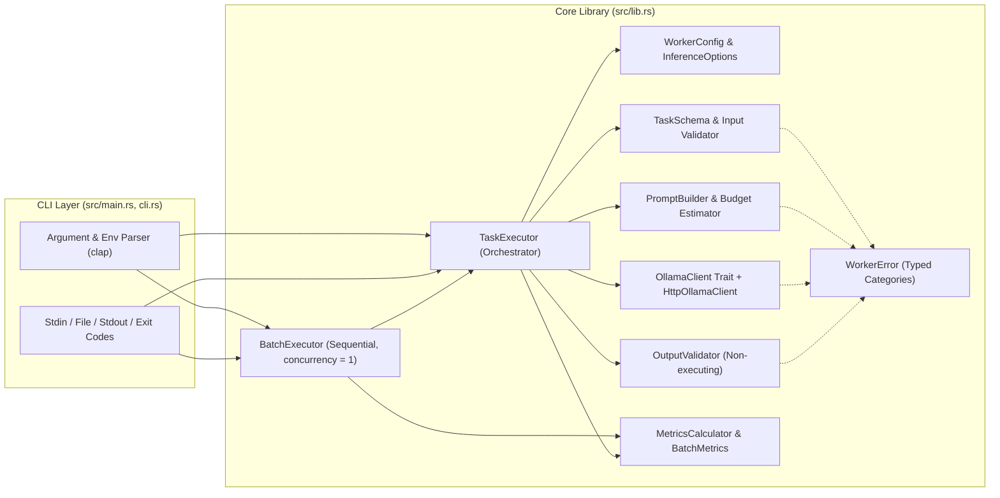
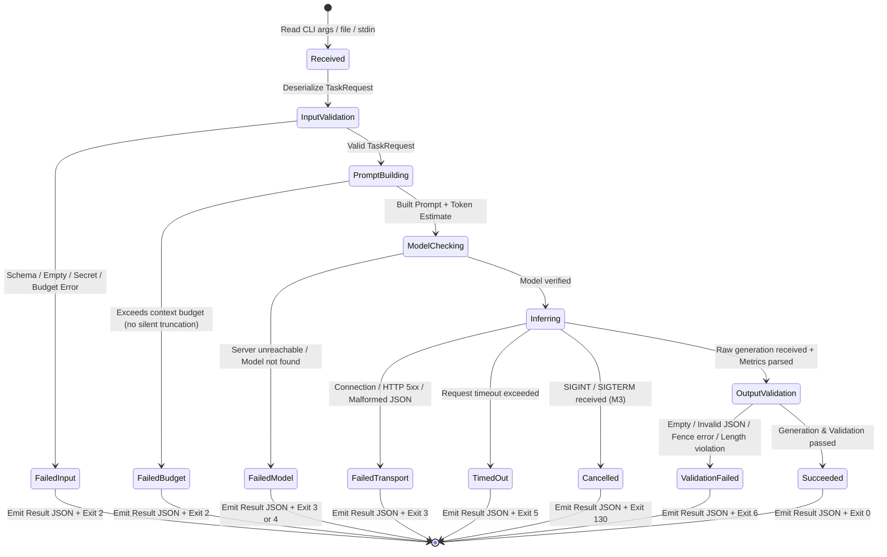
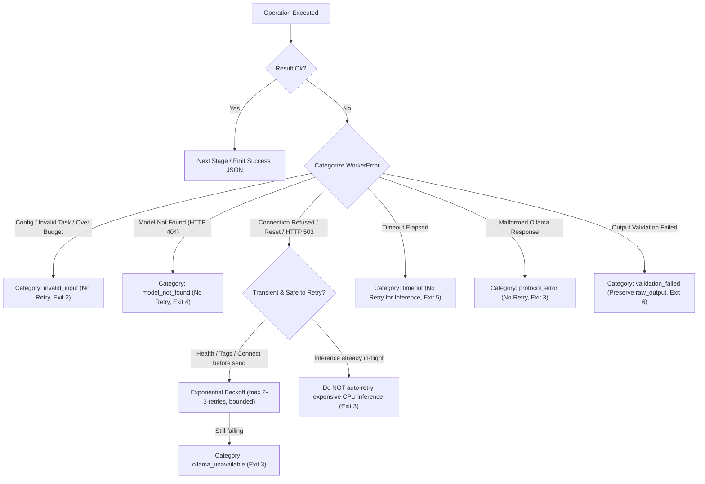

# Architecture & Requirements

## 1. Project Overview

`local-llm-worker` (CLI binary: `ollama-worker`, library crate: `ollama_worker`) is a lightweight Rust worker that bridges senior AI agents (such as Codex or LoopForge orchestrators) and a local Ollama server.

### Target Environment

- **Home Server:** Linux `amd64`, Intel Core i5-1135G7 (4 cores / 8 threads), 8 GB RAM, 8 GB Swap.
- **Local Inference:** Ollama in Docker accessible on host loopback `http://127.0.0.1:11434`, running `qwen2.5-coder:3b` (Q4_K_M, ~2.4 GB loaded memory, CPU inference).
- **Co-located Services:** LoopForge `v0.4.3` (Docker), LoopForge Runner `v0.13.2` (native `systemd` user service), Tailscale, Muse, Crafty Controller.

### Problem Statement

Running a 3B CPU-bound model through heavyweight autonomous coding-agent harnesses (such as OpenCode) injects large system prompts and tool schemas (~4,098 prompt tokens observed vs. ~41 prompt tokens for a direct request), causing sustained ~400% CPU utilization, >10-minute stalls, and failed tool-calling outputs.

`ollama-worker` replaces heavyweight agent loops with narrow, stateless, structured task delegation while leaving architecture, repository-wide reasoning, review, and execution to senior agents and dedicated test runners.

## 2. Functional & Non-Functional Requirements

### Functional Requirements

1. **Ollama Client:** Check server health, list installed models, inspect running models, validate target model existence, execute non-streaming inference (streaming in M3), handle HTTP/network/timeout errors, and extract performance metrics.
2. **Task Management:** Accept strongly typed task inputs via CLI flags, JSON file, or `stdin`, starting with a minimal MVP input and expanding to scoped coding task types in M2.
3. **Prompt Construction:** Build concise, task-specific prompts with explicit context budget checks and **no silent truncation**.
4. **Structured Results:** Emit predictable JSON to `stdout`, logs to `stderr`, explicit exit codes, and separate generation success from output validation success.
5. **Non-Executing Validation:** Validate outputs statically (non-empty, length, code block extraction, JSON schema) without ever executing generated code.

### Non-Functional Requirements

- Minimal runtime RAM and fast CLI startup.
- Zero modifications to existing Home Server services or global Ollama settings.
- Full offline testability using mock HTTP servers without requiring a live LLM.
- Independent of LoopForge at its core; reusable as a Rust library (`ollama_worker`).

## 3. System Architecture

## 4. Component Relationships

## 5. Task Lifecycle

## 6. Error Handling & Reliability Flow

### Reliability vs. Inference Cost Trade-off

Expensive CPU inference requests are **never automatically retried** once sent or timed out, because retrying a slow CPU request stacks load on Ollama and can starve co-located services on an 8 GB RAM host. Bounded exponential backoff retries (M3) apply exclusively to cheap, idempotent metadata/health endpoints or pre-request connection setup.
