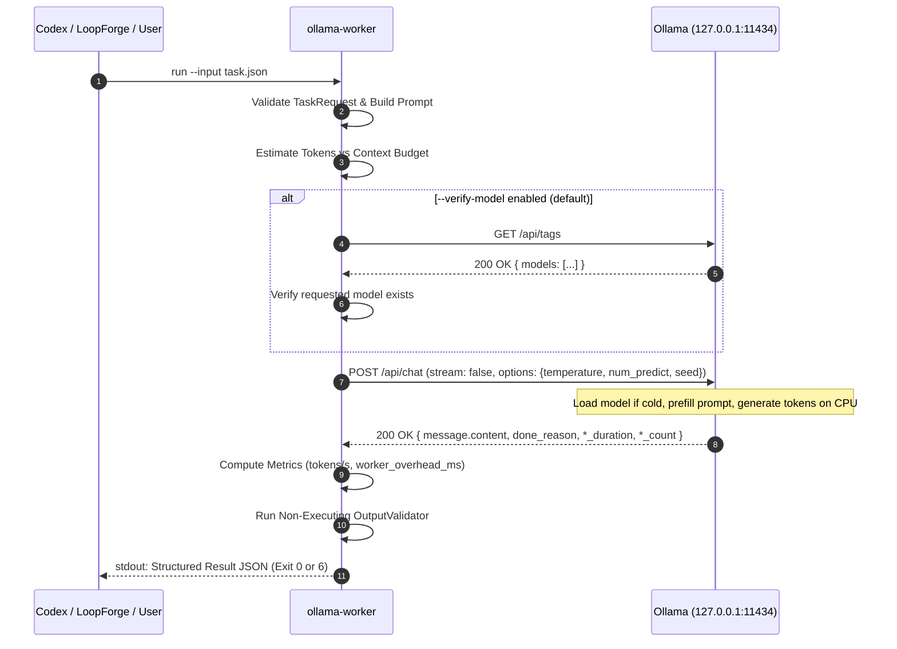

# Contracts: Task Schema, CLI & Ollama Integration

## 1. Task Input Schema (`schema_version = "1"`)

All optional extension fields use `#[serde(default)]` so minimal inputs remain valid.

```json
{
  "schema_version": "1",
  "task_id": "task-001",
  "task_type": "generate_function",
  "language": "python",
  "instruction": "Implement a function that checks whether an integer is prime.",
  "context": "",
  "constraints": [
    "Use Python standard library only",
    "Return only the implementation",
    "Do not modify files"
  ],
  "model": "qwen2.5-coder:3b",
  "options": {
    "temperature": 0.1,
    "num_ctx": 4096,
    "max_tokens": 512,
    "seed": 42
  },
  "output_expectation": {
    "format": "code",
    "extract_code_block": true,
    "max_output_chars": 8000
  }
}
```

### Task Type Rollout

- **M1:** `freeform` (direct task prompt via `--task` or minimal input).
- **M2:** `generate_function`, `generate_unit_test`, `generate_docstring`, `explain_code`, `refactor_function`, `fix_bug`, `generate_json`.
- **M3+:** `generate_sql`, `generate_regex`, `convert_language`.

## 2. Structured Task Result Schema

The result distinguishes **generation success** from **validation success** and preserves `raw_output` for diagnostics. All numeric values below are illustrative schema placeholders, not benchmark measurements.

```json
{
  "schema_version": "1",
  "task_id": "task-001",
  "status": "success",
  "model": "qwen2.5-coder:3b",
  "output": "def is_prime(n: int) -> bool:\n    ...",
  "raw_output": "```python\ndef is_prime(n: int) -> bool:\n    ...\n```",
  "done_reason": "stop",
  "validation": {
    "passed": true,
    "extracted_code_block": true,
    "checks": [
      { "name": "non_empty", "passed": true, "detail": null }
    ],
    "warnings": []
  },
  "metrics": {
    "worker_overhead_ms": 0,
    "ttft_ms": null,
    "total_duration_ms": 0,
    "load_duration_ms": 0,
    "prompt_eval_duration_ms": 0,
    "eval_duration_ms": 0,
    "prompt_tokens": 0,
    "generated_tokens": 0,
    "prompt_tokens_per_second": 0.0,
    "generation_tokens_per_second": 0.0
  },
  "error": null
}
```

### Allowed `status` Values

- `success`: Inference succeeded and all output validations passed.
- `validation_failed`: Inference succeeded, but static output validation failed (`raw_output` and `metrics` preserved).
- `timeout`: Request exceeded configured timeout.
- `cancelled`: Interrupted by `SIGINT`/`SIGTERM` (M3).
- `error`: Input, configuration, model discovery, transport, or protocol error.

## 3. CLI Interface (`ollama-worker`)

```bash
ollama-worker health [--json] [--base-url URL] [--allow-remote-ollama] [--pretty]
ollama-worker models [--json] [--base-url URL] [--pretty]
ollama-worker run --model qwen2.5-coder:3b --type generate_function --lang python --task "Write is_prime"
ollama-worker run --input task.json [--output result.json] [--quiet] [--stream] [--pretty]
cat task.json | ollama-worker run --stdin [--stream]
ollama-worker run --input task.json --dry-run [--pretty]
ollama-worker benchmark --model qwen2.5-coder:3b [--suite FILE] [--endpoint chat|generate|both] [--stream] [--cold-start] [--iterations N]
```

### Stream Separation & Exit Codes

- `stdout`: Strictly machine-readable JSON output for `run` (and when `--json` is passed to `health`/`models`).
- `stderr`: Structured logs (`tracing`), diagnostics, and warnings.

| Exit Code | Meaning |
| :--- | :--- |
| `0` | Success (`status == "success"`) |
| `1` | Unexpected internal error |
| `2` | Invalid input, configuration error, or context budget exceeded |
| `3` | Ollama unavailable, network/HTTP 5xx error, or malformed protocol response |
| `4` | Requested model not found |
| `5` | Request timeout |
| `6` | Output validation failed (`status == "validation_failed"`) |
| `130` | Cancelled via `SIGINT` (`128 + 2`) |

### Configuration Precedence

`CLI Flags > Task JSON options > Environment Variables > Built-in Defaults`

Supported environment variables:

- `OLLAMA_BASE_URL` (default: `http://127.0.0.1:11434`)
- `OLLAMA_WORKER_MODEL`
- `OLLAMA_WORKER_TIMEOUT_SECS` (default: `120`)
- `RUST_LOG` (default: `warn`)

## 4. Native Ollama API Integration

`ollama-worker` targets the **Native Ollama API** rather than `/v1` to retain nanosecond timing metrics and per-request inference options.

| Endpoint | Method | Purpose | Milestone |
| :--- | :--- | :--- | :--- |
| `/api/version` | `GET` | Lightweight server liveness and version check | M1 |
| `/api/tags` | `GET` | List installed models and verify model existence | M1 |
| `/api/ps` | `GET` | Inspect currently loaded models and memory usage | M1 / M3 |
| `/api/chat` | `POST` | Primary stateless 2-message (`system` + `user`) inference without `tools` (non-streaming & NDJSON streaming) | M1–M3 |
| `/api/generate` | `POST` | Benchmark comparison against `/api/chat`, cold-start unload (`keep_alive: "0"`), and future FIM (`suffix`) | M3 |
| `/api/show` | `POST` | Optional future enhancement for verbose model metadata inspection | Future |

### Per-Request Inference Defaults (CPU 3B Model)

- `temperature`: `0.1` for code/JSON tasks, `0.2` for explanations.
- `num_predict` (`max_tokens`): `512` default (configurable, bounded).
- `num_ctx`: Omitted by default in M1 to avoid forcing Ollama to unload/reload an already-loaded `8192`-context model; benchmarked explicitly (`4096` vs `8192`) in M3.
- `keep_alive`: Respects Ollama's default (`5m`) unless explicitly overridden per request.
- `stream`: `false` in M1–M2; optional `true` in M3 for TTFT and cancellation.

### Ollama Request Sequence


