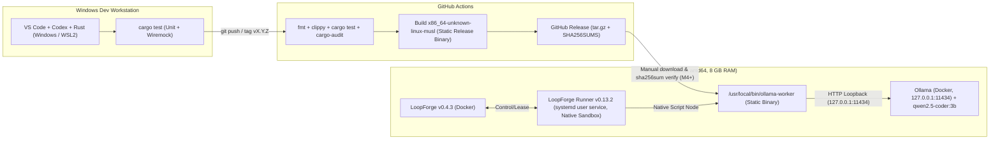

# Development & Deployment Guide

## 1. Development Environment

- **Workstation:** Windows with VS Code and Rust `stable` (`rustc 1.100.0`, Edition `2024`). WSL2 is available as an optional local Linux verification environment.
- **Target Production Host:** Linux `amd64` Home Server (8 GB RAM). Do **not** install Rust build toolchains on the Home Server; deploy pre-built versioned release binaries instead.

## 2. CI/CD & Release Strategy

- **Continuous Integration (`.github/workflows/ci.yml`):**
  - Runs on every push and pull request across Linux (`ubuntu-latest`) and Windows (`windows-latest`).
  - Enforces `cargo fmt --check`, `cargo clippy --all-targets -- -D warnings`, and `cargo test`.
  - Runs `cargo audit` (scheduled / CI security job) to monitor RustSec advisories.
- **Release Builds (M3, `.github/workflows/release.yml`):**
  - Triggered by version tags (`vX.Y.Z`).
  - Builds a statically linked Linux `amd64` binary (`x86_64-unknown-linux-musl`) for maximum portability across Linux distributions regardless of `glibc` version.
  - Publishes tarballs and `SHA256SUMS` to GitHub Releases.

## 3. Deployment Architecture

## 4. Commit & Pull Request Conventions

- Use clean English **Conventional Commits** (`feat:`, `fix:`, `docs:`, `chore:`, `test:`, `refactor:`).
- Do **not** include internal milestone labels (`M1`, `M2`, `M1.1`, etc.) in commit messages or pull request titles/descriptions; keep milestone identifiers restricted to planning documentation.
