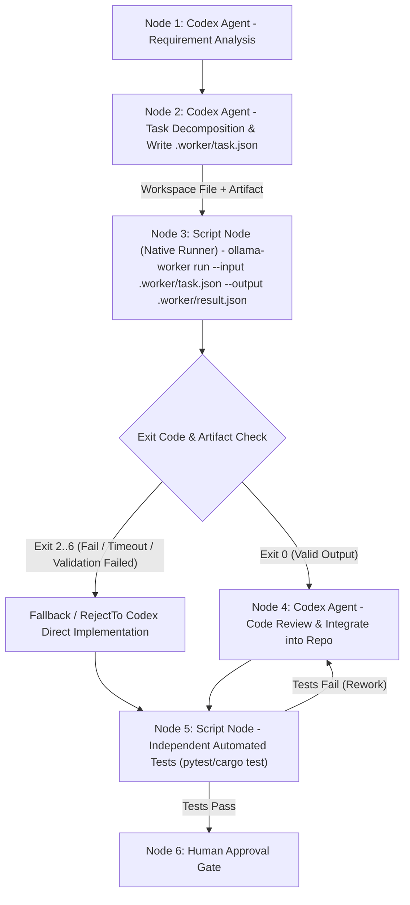

# Integrations: LoopForge & Codex

## 1. LoopForge `v0.4.3` + Runner `v0.13.2` Integration

Verified directly against `Tencent/LoopForge@v0.4.3` source code (`docs/deployment.md`, `internal/domain/workflow.go`, `internal/engine/node_execute.go`, `internal/engine/node_outputs.go`, `internal/runtime/sandbox_local.go`, `internal/runtime/sandbox_docker.go`, `internal/runner/exec.go`).

### Verified Platform Capabilities

- **Script Nodes:** `WorkflowNode.Type == "script"` supports `scriptLanguage: "shell" | "python"` executed via `sh -lc <script>` in the active sandbox, with `MaxAttempts`, `MaxReworks`, `OnFailure` (`fail` | `reject`), and `RejectTo`.
- **Inter-Node Data & Artifacts:** Nodes share the run workspace and declare `ArtifactOutputs` (`[]ArtifactContract` with workspace-relative paths). The engine validates required artifacts after node completion and stores them for downstream nodes.
- **Environment & Credentials:** Supports `CredentialEnv` (platform-managed secrets injected without exposing values in definitions or logs) and sandbox environment variables.
- **Cancellation & Exit Codes:** Runner `v0.13.2` manages task leases (30s renew, 1s control fallback), signals cancellation to the child process group (`Setpgid: true`, 10s grace), and maps non-zero exit codes to node failure. Because Script Nodes do not enforce a dedicated per-script timeout field in `WorkflowNode`, `ollama-worker`'s own `--timeout` is essential.

### Networking & Execution Environment Analysis

- **Docker Sandbox (`generic-docker`):** Runs sibling containers on a Docker network; `--add-host host.docker.internal:host-gateway` is only enabled for conversation workspaces or runner login relay, and host loopback `127.0.0.1:11434` is not reachable from another container's network namespace without reconfiguring Ollama/Docker networking.
- **Native Sandbox on Personal Runner `v0.13.2` (Recommended):** Executes processes directly on the Runner host via `os/exec` in the host network namespace. Installing the static `ollama-worker` release binary on the Runner host allows Script Nodes to reach `http://127.0.0.1:11434` directly with **zero changes** to Ollama, Docker, Tailscale, or LoopForge source code.

### Proposed LoopForge Workflow

## 2. Standalone Codex Integration

Codex can invoke `ollama-worker` independently of LoopForge starting in M2:

1. **Direct CLI / `stdin` JSON:** Pipe a `TaskRequest` JSON into `ollama-worker run --stdin` and parse the structured JSON returned on `stdout`.
2. **Repository Delegation Instructions (`AGENTS.md`):** Document the exact schema, exit codes, and mandatory review step so Codex delegates only appropriate subtasks.
3. **Future MCP Server (M5, optional):** Expose `ollama_worker` via a `stdio` MCP server only after CLI delegation proves its value.

### Task Delegation Criteria

| Criterion | Delegate to `ollama-worker` (`qwen2.5-coder:3b`) | Keep on Senior Agent (Codex) |
| :--- | :--- | :--- |
| **Context Scope** | Self-contained, <= 1–2 short snippets (~100–500 token target) | Multi-file architecture, repository-wide refactoring |
| **Logic Complexity** | Isolated helper functions, basic unit tests, docstrings, boilerplate, simple regex/SQL | Concurrency, complex debugging, integration design |
| **Security Sensitivity** | Non-security-critical logic | Auth, cryptography, permissions, untrusted I/O |
| **Verifiability** | Fast human scan or isolated unit test | Requires system-wide reasoning |
